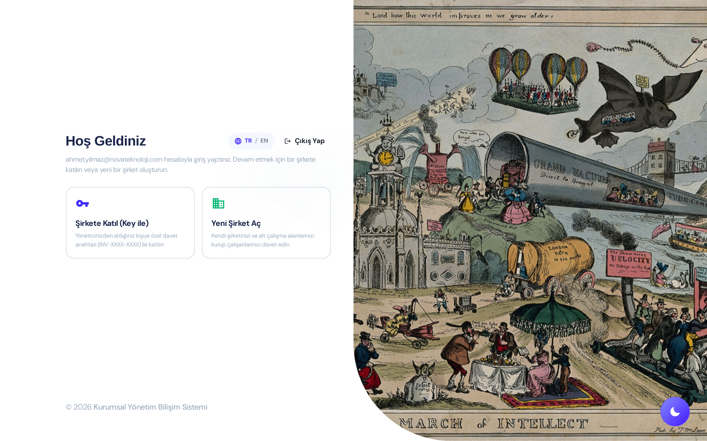
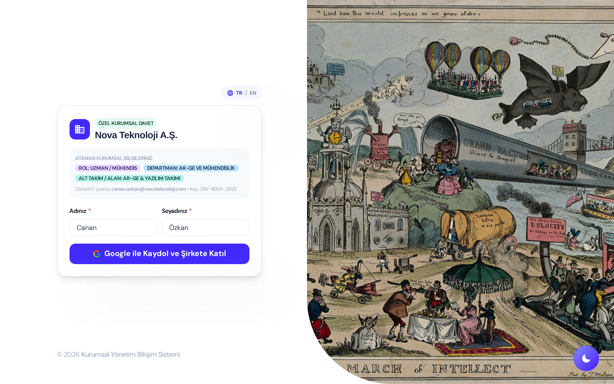
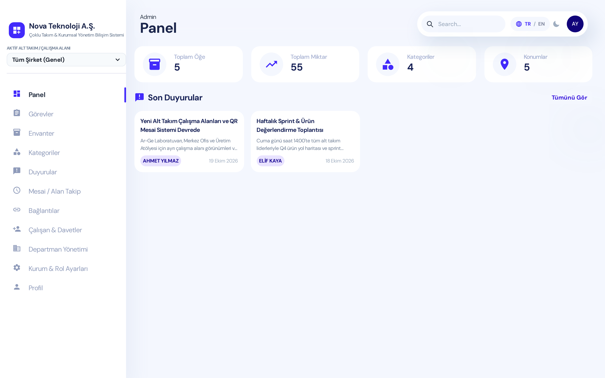
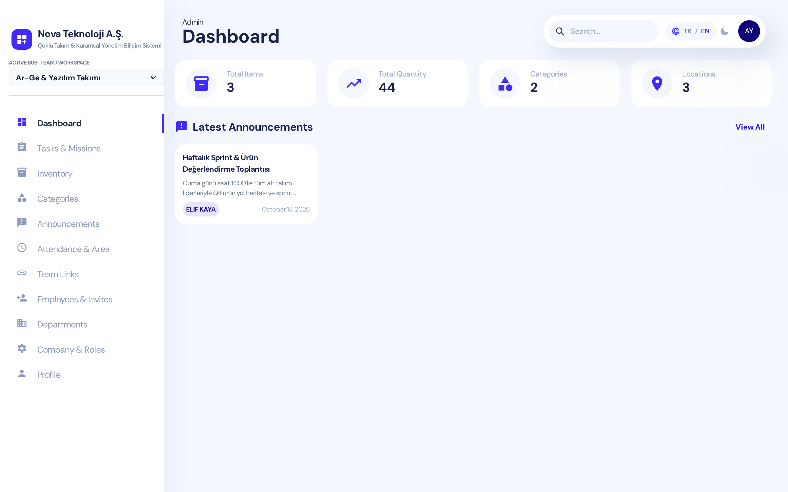
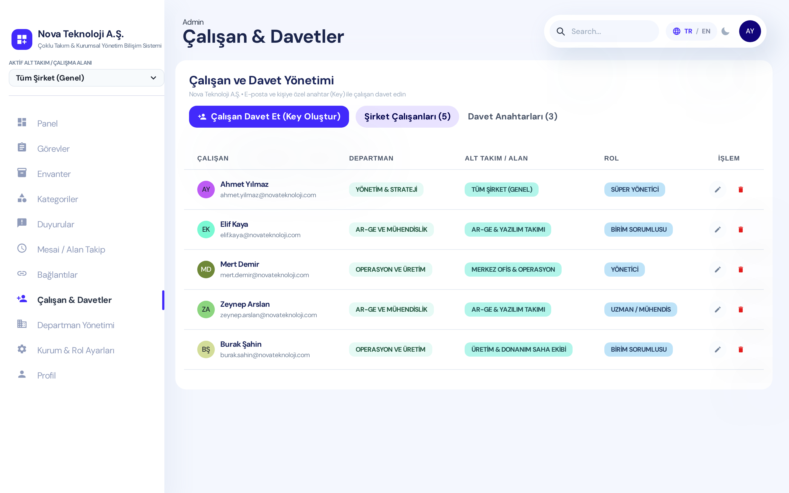
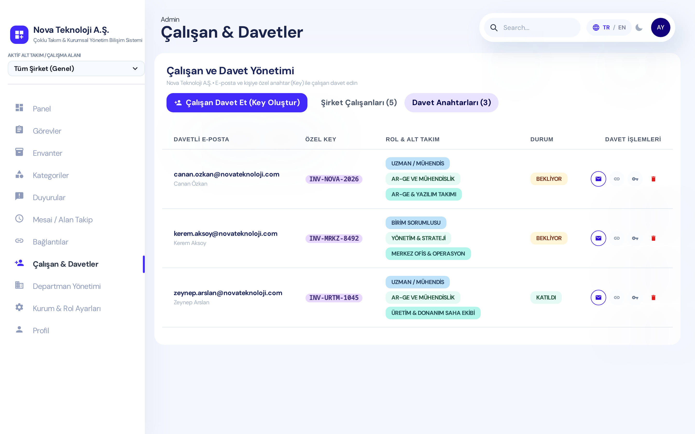
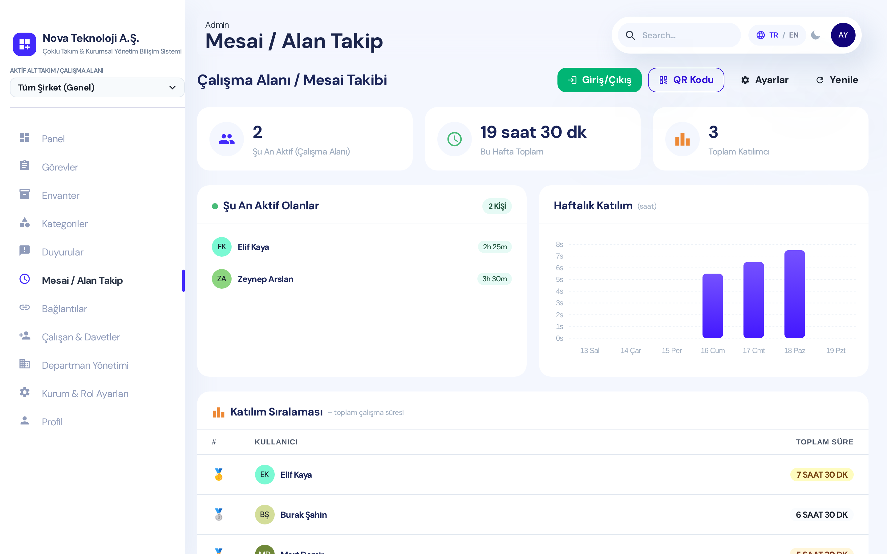
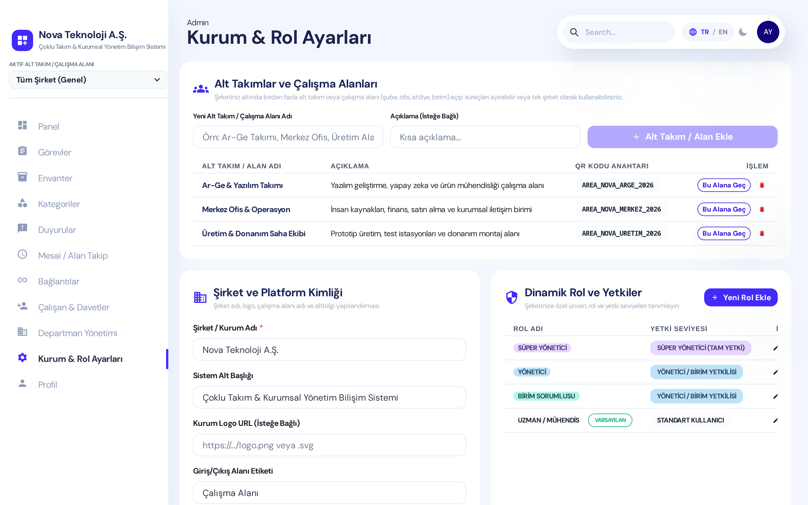
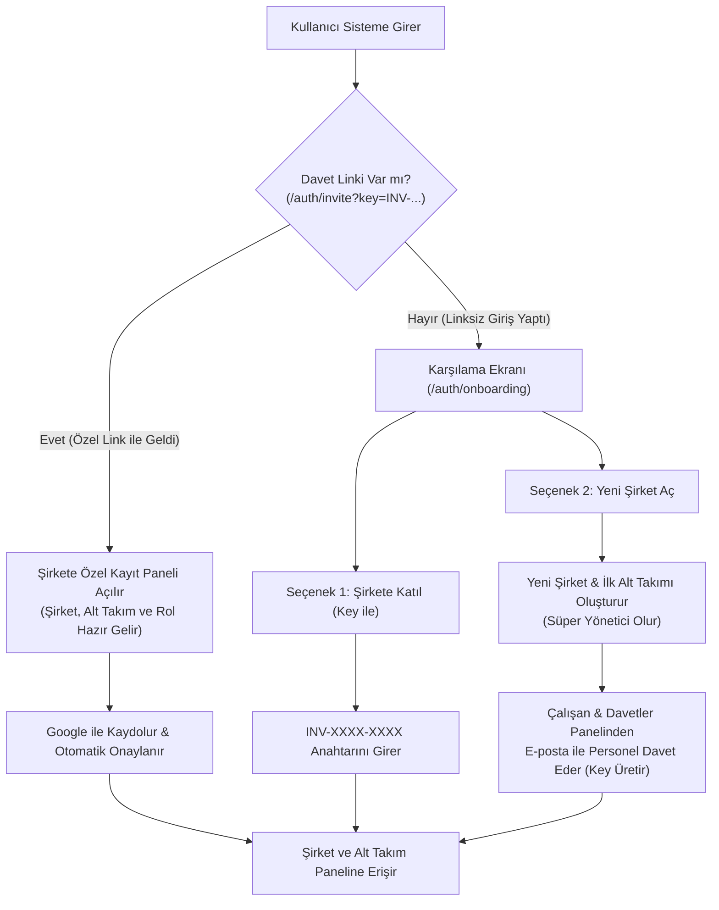

<div align="center">

# 🏢 Kurumsal YBS — Çoklu Şirket & Alt Takım Yönetim Bilişim Sistemi
### *(Enterprise Multi-Company & Sub-Team Management Information System)*

**React • TypeScript • Chakra UI • Firebase (Auth & Firestore) • Çoklu Dil (TR / EN)**

[](./LICENSE)
[](https://react.dev/)
[](https://www.typescriptlang.org/)
[](https://firebase.google.com/)
[](#)

</div>

---

## 📌 Bu Sistem Ne İşe Yarar? *(What Does This Platform Do?)*

**Kurumsal YBS**, herhangi bir şirketin, kurumun, üretim tesisinin, teknoloji ekibinin veya organizasyonun **günlük operasyonlarını tek bir merkezden yönetmesini** sağlayan açık kaynaklı, **çoklu şirket (multi-tenant)** ve **çoklu alt takım (sub-team / workspace)** destekli bir **Yönetim Bilişim Sistemidir (MIS)**.

Sistemi tek bir şirket olarak kullanabileceğiniz gibi; aynı platform üzerinde **A Şirketi, B Şirketi, C Şirketi** gibi birbirinden tamamen bağımsız şirketler açabilir, her şirketin altında **birden fazla alt takım, şube, ofis veya çalışma alanı** (ör. *Ar-Ge & Yazılım Takımı*, *Merkez Ofis & Operasyon*, *Üretim & Donanım Saha Ekibi*) kurabilirsiniz.

### 🎯 Çözüm Ürettiği Temel Problemler
1. **Çoklu Şirket & Alt Çalışma Alanı İzolasyonu:** Bir şirket tek başına tüm modülleri kullanabilir veya kendi bünyesinde alt takımlar açarak her takımın envanterini, görevlerini, duyurularını ve mesai/giriş-çıkış takibini ayırabilir.
2. **Kişiye Özel Davet Anahtarı (`INV-XXXX-XXXX`) ve Özel Kayıt Linki:** Yöneticiler çalışanlarını e-posta adresiyle tek tek davet eder. Sistem her davet için benzersiz bir **Key** ve **özel kayıt bağlantısı (`/auth/invite?key=INV-XXXX-XXXX`)** üretir.
3. **Linksiz Girişlerde Akıllı Karşılama (`Şirkete Katıl` veya `Yeni Şirket Aç`):** Sisteme davet linki olmadan doğrudan giriş yapan bir kullanıcıya iki net seçenek sunulur:
   - 🔑 **Şirkete Katıl (Key ile):** Yöneticisinden aldığı `INV-XXXX-XXXX` anahtarını girerek şirketine ve alt takımına katılır.
   - 🏢 **Yeni Şirket Aç:** Kendi şirketini ve ilk alt çalışma alanını saniyeler içinde oluşturup **Süper Yönetici** olur.
4. **QR Kod & GPS Tabanlı Mesai / Çalışma Alanı Takibi:** Çalışanların ofise, şubeye veya çalışma alanına giriş-çıkış saatlerini QR kod tarayarak ve GPS konum doğrulamasıyla canlı olarak takip eder; haftalık çalışma grafikleri ve katılım sıralaması (leaderboard) sunar.
5. **Görev, Envanter, Duyuru ve Dinamik Rol Yönetimi:** Kod değiştirmeden şirkete özel ünvan/rol tanımlama, stok ve demirbaş takibi, görev atama ve ilerleme geçmişi tutma imkânı sağlar.
6. **Çift Dil Desteği (`TR` / `EN`):** Üst barda ve giriş ekranlarında yer alan dil değiştirici (`TR / EN`) ile arayüz anında **Türkçe** veya **İngilizce** olarak kullanılabilir.

---

## 🖼️ Uygulama Ekran Görüntüleri *(Application Screenshots)*

### 1. Karşılama Ekranı: Şirkete Katıl (Key ile) veya Yeni Şirket Aç
Davet linki olmadan giriş yapan kullanıcılar, ellerindeki davet anahtarıyla mevcut bir şirkete katılabilir veya sıfırdan yeni bir şirket kurabilirler:



---

### 2. Kişiye Özel Davet Linki ve Kayıt Paneli (`/auth/invite?key=INV-NOVA-2026`)
Yönetici tarafından e-posta ile gönderilen davet bağlantısına tıklayan çalışanın karşısına; katılacağı şirket, önceden atanmış rolü, departmanı ve alt takımı hazır olarak gelir:



---

### 3. Kurumsal Yönetim Paneli & Alt Takım Seçici (Türkçe — `TR`)
Sol menüdeki **Aktif Alt Takım / Çalışma Alanı** seçicisi ile **Tüm Şirket (Genel)** veya belirli bir alt takım arasında anında geçiş yapılabilir:



---

### 4. İngilizce Arayüz & Alt Takım Filtrelemesi (English — `EN`)
Üst bardaki **`TR / EN`** dil seçeneği ile tüm sistem İngilizceye geçer. Aşağıdaki ekranda yalnızca **Ar-Ge & Yazılım Takımı** çalışma alanına ait veriler filtrelenmiştir:



---

### 5. Çalışan Yönetimi ve Kişiye Özel Davet Anahtarları (`Key`)
Yöneticiler şirket çalışanlarını görüntüleyebilir, departman/alt takım/rol atamalarını düzenleyebilir ve yeni çalışanlar için `INV-XXXX-XXXX` formatında davet anahtarı oluşturabilir:



#### 🔑 Oluşturulan Davet Anahtarları ve E-posta / Link Paylaşım Tablosu
Her davet için tek tıkla **E-posta Gönder**, **Kayıt Linkini Kopyala** ve **Key Kopyala** aksiyonları yer alır:



---

### 6. QR Kod & GPS Destekli Mesai / Çalışma Alanı Takibi
Şu an çalışma alanında aktif olan çalışanları, haftalık toplam çalışma saatlerini, günlük sütun grafiklerini ve en çok katılım sağlayan çalışan sıralamasını canlı olarak gösterir:



---

### 7. Alt Takımlar, Kurumsal Kimlik (White-Label) ve Dinamik Rol Ayarları
Her şirket kendi alt takımlarını (ve her alt takımın kendine özel QR kod anahtarını), şirket adını/logosunu ve özel yetki seviyelerine sahip rollerini (`Süper Yönetici`, `Yönetici`, `Birim Sorumlusu`, `Uzman / Mühendis` vb.) dinamik olarak yönetebilir:



---

## 🔄 Sistem Akış Şeması *(Workflow Architecture)*



---

## 🌍 English Summary *(Overview in English)*

**Kurumsal YBS** is an open-source, white-label **Multi-Company & Sub-Team Management Information System** built with React, TypeScript, Chakra UI, and Firebase.

- **Multi-Company & Sub-Team Isolation:** Host multiple independent companies (`Company A`, `Company B`, `Company C`) on the same platform. Each company can operate as a single unified workspace or divide operations into multiple **Sub-Teams / Workspaces** (e.g., *R&D Lab*, *HQ Operations*, *Production Floor*).
- **Personal Invitation Keys (`INV-XXXX-XXXX`):** Managers invite employees by email, pre-assigning their **Role**, **Department**, and **Sub-Team**. Each invitation generates a unique key and a direct registration URL (`/auth/invite?key=INV-XXXX-XXXX`).
- **Dual Onboarding Flow (`/auth/onboarding`):** Users signing in without an invite link are presented with two choices: **Join a Company (with Key)** or **Create a New Company**.
- **QR & GPS Attendance Tracking:** Real-time check-in/check-out verification via QR code scanning and optional GPS geofencing, complete with weekly hour analytics and leaderboards.
- **Built-in Bilingual Support (`TR` / `EN`):** Instant language switching between Turkish and English across authentication, navigation, dashboards, and management panels.

---

## 🚀 Kurulum ve Çalıştırma *(Getting Started)*

### 1. Gereksinimler *(Prerequisites)*
- **Node.js** `18.x` veya üzeri
- **npm** veya **yarn**
- Bir **Firebase** projesi (Authentication -> Google Sign-In aktif ve Cloud Firestore oluşturulmuş olmalı; *Firebase olmadan da giriş ekranındaki **Hızlı Önizleme & Demo Modu** butonlarıyla tüm sistemi hemen test edebilirsiniz*)

### 2. Projeyi Klonlayın ve Bağımlılıkları Yükleyin
```bash
git clone https://github.com/isaaltunoglu/kurumsal-ybs.git
cd kurumsal-ybs
npm install --legacy-peer-deps
```

### 3. Ortam Değişkenlerini (`.env`) Yapılandırın
Proje kök dizinindeki `.env.example` dosyasını `.env` olarak kopyalayın ve kendi Firebase proje bilgilerinizle doldurun:

```bash
cp .env.example .env
```

```env
REACT_APP_FIREBASE_API_KEY=your_api_key
REACT_APP_FIREBASE_AUTH_DOMAIN=your_project.firebaseapp.com
REACT_APP_FIREBASE_PROJECT_ID=your_project_id
REACT_APP_FIREBASE_STORAGE_BUCKET=your_project.firebasestorage.app
REACT_APP_FIREBASE_MESSAGING_SENDER_ID=your_sender_id
REACT_APP_FIREBASE_APP_ID=your_app_id
```

### 4. Uygulamayı Yerel Bilgisayarınızda Başlatın
```bash
npm start
```
Tarayıcınızda `http://localhost:3000` adresine gidin.
> 💡 **İpucu:** Firebase ayarlarınızı henüz girmediyseniz bile giriş ekranındaki **"Örnek Şirket Paneli"** veya **"Şirket Aç / Katıl Ekranı"** butonlarına tıklayarak örnek verilerle (`Nova Teknoloji A.Ş.`) tüm modülleri canlı olarak inceleyebilirsiniz.

---

## ☁️ Firebase Hosting'e Yükleme *(Deploying to Firebase)*

Uygulamayı kendi Firebase projenize yayınlamak için:

```bash
# 1. Production paketini derleyin
npm run build

# 2. Firebase CLI ile giriş yapın (henüz yapmadıysanız)
npx firebase-tools login

# 3. Firebase projenizi bağlayın
npx firebase-tools use --add

# 4. Firestore kurallarını ve Hosting'i yayınlayın
npx firebase-tools deploy
```

---

## 📂 Proje Dizin Yapısı *(Directory Structure)*

```text
src/
├── components/
│   ├── navbar/
│   │   ├── LanguageSwitcher.tsx    # TR / EN Dil değiştirici bileşen
│   │   └── NavbarLinksAdmin.tsx    # Üst bar kontrolleri ve bildirimler
│   └── sidebar/
│       └── components/
│           ├── Brand.tsx           # Dinamik Şirket Logosu + Alt Takım Seçici
│           └── Links.tsx           # Yetki ve dil duyarlı menü bağlantıları
├── contexts/
│   ├── AuthContext.tsx             # Kullanıcı, şirket, alt takım, rol ve Demo Modu yönetimi
│   ├── LanguageContext.tsx         # Türkçe / İngilizce (TR/EN) dil bağlamı
│   └── OrganizationContext.tsx     # Aktif şirket kimliği, alt takımlar ve dinamik roller
├── services/
│   ├── tenantScope.ts              # Şirket (companyId) ve Alt Takım (subTeamId) veri izolasyonu
│   ├── companyService.ts           # Şirket ve alt takım (Sub-Team) CRUD servisleri
│   ├── inviteService.ts            # Kişiye özel davet anahtarı (INV-XXXX-XXXX) servisi
│   ├── demoData.ts                 # Örnek şirket (Nova Teknoloji A.Ş.) ve alt takım verileri
│   ├── organizationService.ts      # White-label şirket ayarları servisi
│   ├── roleService.ts              # Dinamik rol ve yetki servisi
│   ├── departmentService.ts        # Departman yönetimi servisi
│   ├── missionService.ts           # Görev ve proje takibi servisi
│   ├── inventoryService.ts         # Envanter ve stok servisi
│   ├── categoryService.ts          # Envanter kategorileri servisi
│   ├── announcementService.ts      # Kurum içi duyuru servisi
│   ├── linkService.ts              # Takım bağlantıları servisi
│   └── workshopService.ts          # QR & GPS mesai / çalışma alanı takip servisi
└── views/
    ├── auth/
    │   ├── signIn/                 # Giriş ekranı + Key ile Kaydol + Hızlı Demo Önizleme
    │   ├── onboarding/             # Linksiz giriş: "Şirkete Katıl (Key)" veya "Yeni Şirket Aç"
    │   └── invite/                 # Özel davet linki (/auth/invite?key=...) kayıt ekranı
    └── admin/
        ├── dashboard/              # Genel bakış ve son duyurular
        ├── missions/               # Görevlerim & Tüm Görevler yönetimi
        ├── inventory/              # Envanter & Stok yönetimi
        ├── categories/             # Kategori yönetimi
        ├── announcements/          # Duyuru yönetimi
        ├── workshop/               # QR Kod & GPS Mesai / Çalışma Alanı takibi
        ├── links/                  # Kurum içi önemli bağlantılar
        ├── userApprovals/          # Çalışanlar & Kişiye Özel Davet Anahtarı (Key) yönetimi
        ├── departments/            # Departman yönetimi
        ├── settings/               # Alt Takımlar, Şirket Kimliği ve Dinamik Roller
        └── profile/                # Kullanıcı profili ve haftalık mesai istatistikleri
```

---

## 📄 Lisans *(License)*

Bu proje [MIT Lisansı](./LICENSE) altında açık kaynak olarak sunulmaktadır. Dilediğiniz şirket, kurum veya organizasyon için özgürce özelleştirip kullanabilirsiniz.